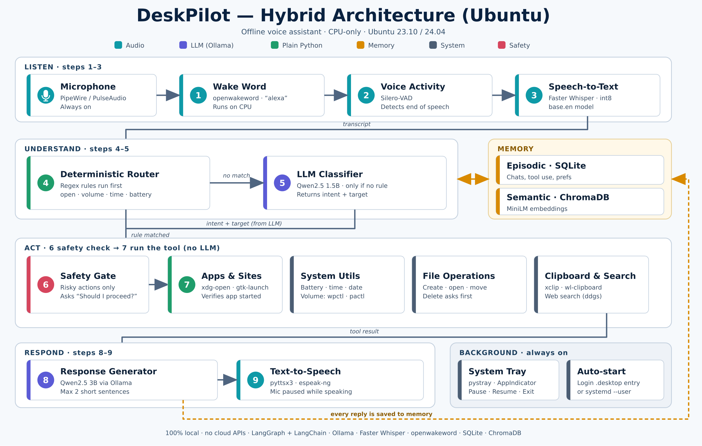

# DeskPilot

An offline, voice-controlled desktop assistant for Ubuntu with:

- Wake word detection (`alexa` via openwakeword/ONNX)
- Offline speech-to-text (Faster Whisper)
- Text-to-speech responses (`pyttsx3` / `espeak-ng`)
- Local LLM intent classification & conversation (Ollama)
- Deterministic Python routing & tool execution
- Episodic (SQLite) and semantic (ChromaDB) memory
- System tray integration (`pystray` / AppIndicator)
- Background startup and autostart support (`deskpilot.desktop`, `deskpilot.service`)

---

## Features

### Voice Assistant

- Wake word activation (`alexa`)
- Speech-to-text using Faster Whisper (`base.en`, CPU `int8`)
- Text-to-speech responses via `espeak-ng`
- Continuous conversation mode
- Silence detection + timeout handling

### Hybrid Agent Architecture

- LLM for intent classification
- Deterministic Python routing
- Deterministic tool execution
- LLM for natural conversation

Architecture diagram:



### Tool System

Supports:

- Open and close applications
- Open websites
- Battery and system status
- Volume control (`wpctl` / `pactl` / `amixer`)
- Clipboard read/write (`xclip` / `wl-clipboard`)
- File operations
- Screenshots (`~/Pictures/Screenshots`)
- Web search

---

## Memory System

### SQLite Episodic Memory

Stores conversations, tool usage, responses, and preferences in `memory/deskpilot_memory.db`.

### ChromaDB Semantic Memory

Stores user preferences and interaction summaries with local embeddings (`sentence-transformers` / `all-MiniLM-L6-v2`) in `memory/chroma_db/`.

Examples:

- `Remember that I prefer dark mode`
- `Remember volume at 40 percent`

---

## Tech Stack

- **AI**: Ollama (`qwen2.5:1.5b` / `qwen2.5:3b`), Faster Whisper, Sentence Transformers, Silero VAD, openwakeword
- **Frameworks**: LangGraph, LangChain, ChromaDB
- **Ubuntu Desktop**: `pystray`, `pyaudio`, `sounddevice`, `soundfile`, `pyttsx3` (`espeak-ng`), `psutil`, `mss`, `pyperclip` (`xclip` / `wl-clipboard`), `wmctrl`, `xdotool`, `ddgs`, `Pillow`

---

## Project Structure

```text
/home/<user>/Desktop/DESKPILOT/
├── assets/
│   └── tray_icon.png
├── logs/
├── memory/
├── src/
│   └── deskpilot/
│       ├── agent/
│       ├── memory/
│       ├── system/
│       ├── ui/
│       ├── utils/
│       ├── voice/
│       └── main.py
├── tests/
├── deskpilot.desktop
├── deskpilot.service
├── deskpilot_architecture.png
├── requirements_linux.txt
├── start_deskpilot.sh
└── README.md
```

---

## Installation (Ubuntu)

### 1. Navigate to the Project

```bash
cd /home/<user>/Desktop/DESKPILOT
```

### 2. Install System Dependencies

```bash
sudo apt update
sudo apt install -y python3-venv python3-dev python3.11-venv python3.11-dev \
  build-essential portaudio19-dev libportaudio2 libsndfile1 ffmpeg espeak-ng \
  xclip xsel wl-clipboard wmctrl xdotool pulseaudio-utils playerctl \
  gir1.2-appindicator3-0.1 python3-gi libgirepository1.0-dev libcairo2-dev
```

### 3. Create Virtual Environment & Install Packages

```bash
python3.11 -m venv .venv --system-site-packages
source .venv/bin/activate
pip install torch --index-url https://download.pytorch.org/whl/cpu
pip install -r requirements_linux.txt
```

### 4. Ollama Setup

Install Ollama from [https://ollama.com](https://ollama.com) (or `curl -fsSL https://ollama.com/install.sh | sh`), then pull the models:

```bash
ollama pull qwen2.5:1.5b
# Optional higher-quality model (if RAM allows):
# ollama pull qwen2.5:3b
ollama list
```

### 5. Configure Environment

```bash
cp .env.example .env
# Edit .env to set OLLAMA_MODEL, WAKE_WORD, WAKE_WORD_THRESHOLD, etc.
```

---

## Running DeskPilot

### Foreground Mode

```bash
/home/<user>/Desktop/DESKPILOT/start_deskpilot.sh
```

### Background Mode

```bash
/home/<user>/Desktop/DESKPILOT/start_deskpilot.sh --bg
```

Logs are written to `logs/deskpilot.log` (and `logs/ollama.log` if Ollama was started by the script).

### Development Mode & Smoke Tests

```bash
cd /home/<user>/Desktop/DESKPILOT
source .venv/bin/activate
python -m src.deskpilot.main
python tests/smoke_test.py
```

---

## Autostart on Ubuntu Login

### Option A: XDG Desktop Entry (`deskpilot.desktop`)

```bash
mkdir -p ~/.config/autostart
cp /home/<user>/Desktop/DESKPILOT/deskpilot.desktop ~/.config/autostart/
```

*(Note: update the absolute paths inside `~/.config/autostart/deskpilot.desktop` if your username is not `varshitha`.)*

### Option B: systemd User Service (`deskpilot.service`)

```bash
mkdir -p ~/.config/systemd/user
cp /home/<user>/Desktop/DESKPILOT/deskpilot.service ~/.config/systemd/user/
systemctl --user daemon-reload
systemctl --user enable deskpilot.service
systemctl --user start deskpilot.service
```

Check status and logs:

```bash
systemctl --user status deskpilot.service
journalctl --user -u deskpilot.service -f
```

---

## System Tray

Features:

- Pause / Resume assistant
- Open Logs (`logs/` via `xdg-open`)
- Clear Memory
- Exit DeskPilot

On GNOME + Wayland, install `gnome-shell-extension-appindicator` if the tray icon does not appear, or log in using **"Ubuntu on Xorg"**.

---

## Safety Features

Risky tools require verbal confirmation before execution:

- File deletion
- Volume changes
- Clipboard overwrite
- Closing applications

Example:

```text
Set volume to 40 percent
→ Should I proceed?
```

---

## Example Commands

### Applications

- `Open Firefox`
- `Open Calculator`
- `Open File Manager`

### Websites

- `Open YouTube`
- `Open GitHub`
- `Open Gmail`

### System & Memory

- `What time is it?`
- `How is my battery?`
- `Set volume to 50 percent`
- `Remember that I prefer dark mode`
